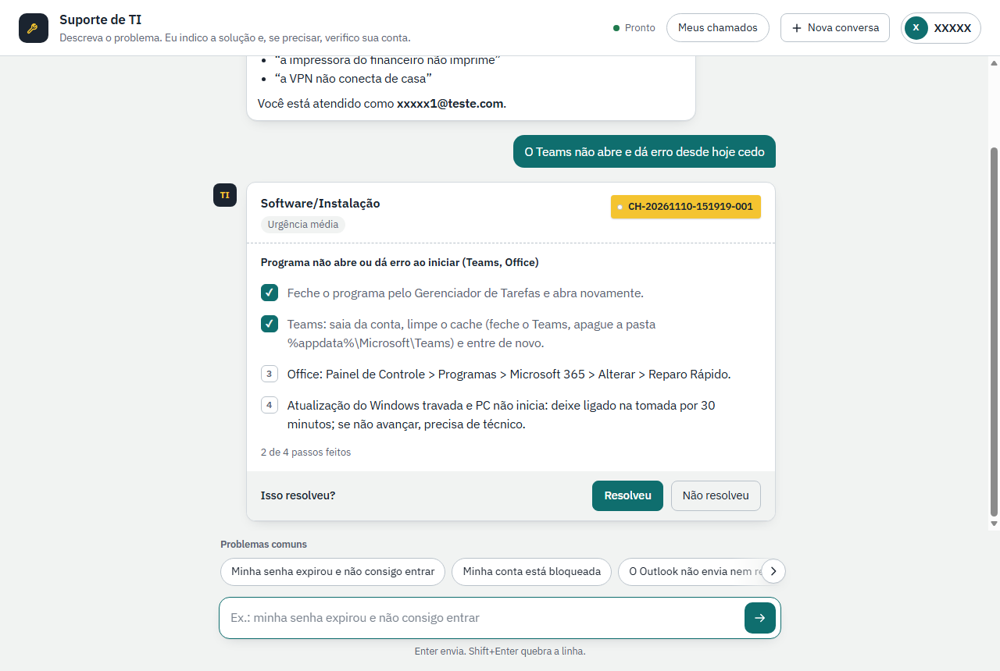
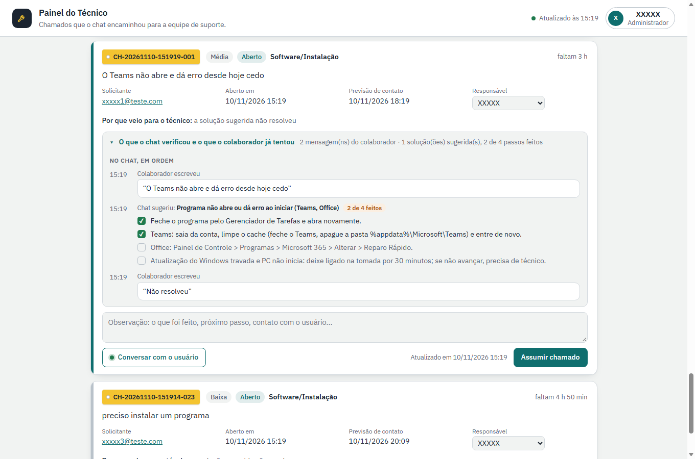
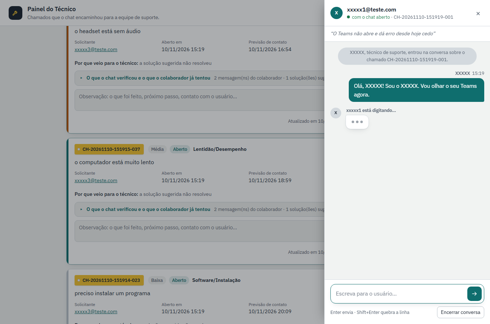
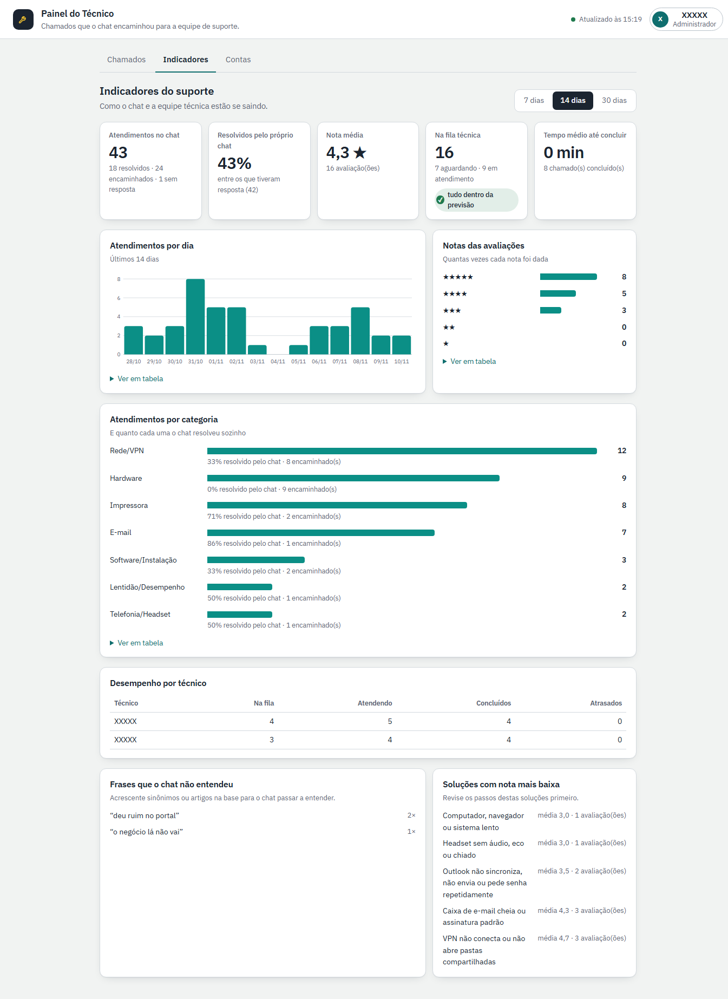
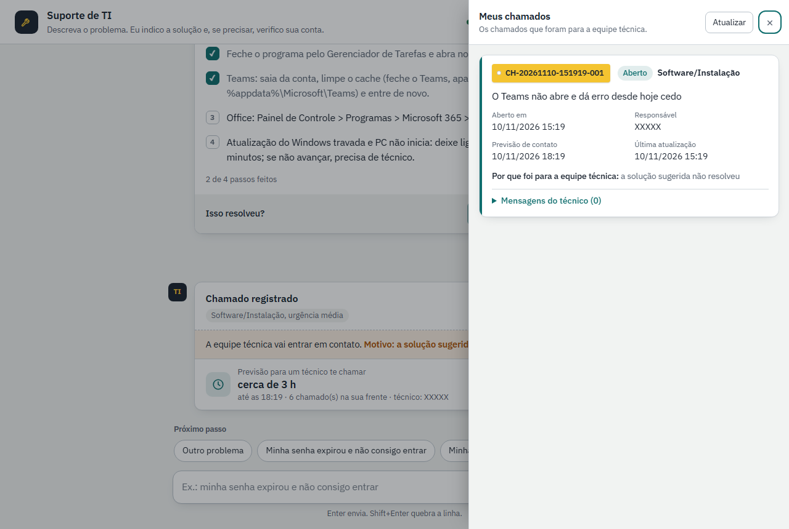
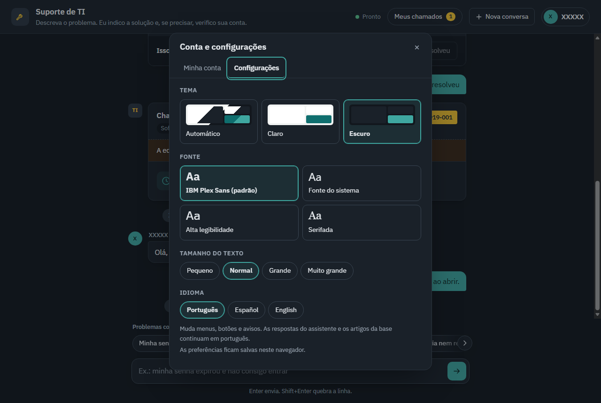
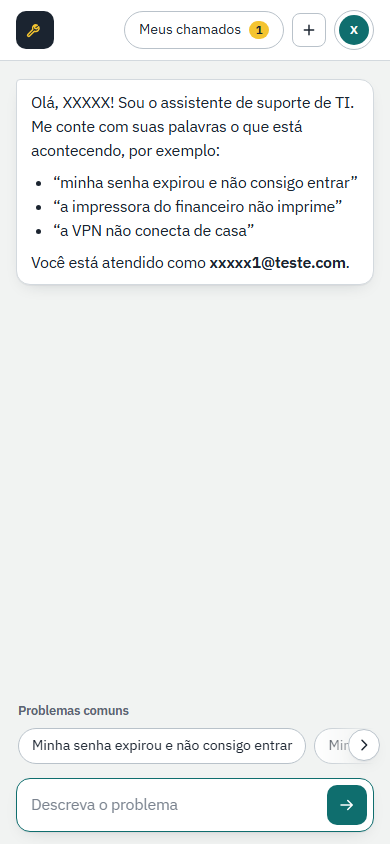

# Central de Suporte de TI: chat de atendimento e painel do técnico

Um balcão de suporte de TI completo que roda no próprio computador: o **colaborador** descreve o problema num chat,
o assistente classifica, sugere a solução passo a passo e, se não resolver, abre um chamado; o **técnico** atende
pelo painel, conversa com a pessoa em tempo real e acompanha indicadores. Sem IA generativa, sem chave de API e sem
internet: a "inteligência" é busca BM25 com radicais, sinônimos e correção de digitação, mais um classificador
(votação por vizinhos + Naive Bayes) treinado numa planilha de chamados rotulados.



| | |
|---|---|
|  |  |
| **Painel do técnico**: chamados por técnico, previsão, e o que o colaborador já tentou (passos marcados no chat). | **Conversa em tempo real** com quem abriu o chamado, com a bolha "digitando" dos dois lados. |
|  |  |
| **Indicadores** (administrador): quanto o chat resolve sozinho, notas, categorias, fila e desempenho. | **Meus chamados**: o colaborador acompanha status, responsável, previsão e mensagens. |
|  |  |
| **Configurações**: tema claro/escuro, fonte, tamanho do texto e idioma (pt, es, en). | Funciona no **celular**. |

### Destaques

- **Triagem automática** (categoria e urgência) e **busca refinada** na base de conhecimento, com correção de digitação.
- **Login para colaborador e técnico**: senha provisória, troca obrigatória no primeiro acesso, bloqueio após 5 erros.
- **Chamados separados por técnico**, distribuição automática pelo menos ocupado e **previsão de atendimento**.
- **Conversa técnico ↔ colaborador** em tempo real, com histórico e avisos de "digitando".
- **Área do administrador**: indicadores (gráficos próprios em SVG, sem bibliotecas) e gestão de contas pela tela.
- **Segurança**: CSP restrita, proteção contra CSRF e DNS rebinding, sessões com expiração por inatividade e CSVs
  protegidos contra injeção de fórmulas do Excel.
- **Acessibilidade e preferências**: tema, fonte, tamanho e idioma; navegação por teclado; respeita "menos movimento".
- **Testes**: mais de 100 testes automáticos (pytest) e testes de ponta a ponta no navegador.

**Tecnologias:** Python 3.12 · FastAPI · openpyxl · Snowball (radicais em português) · HTML/CSS/JavaScript puros
(sem framework, sem build) · Node 22+ e Edge/Chrome (testes de navegador).

## Rodar em 2 minutos (Windows)

1. Instale o [Python 3.12](https://www.python.org/downloads/).
2. Na pasta do projeto, rode uma vez no PowerShell:
   ```powershell
   .\sistema\configurar.ps1
   ```
   Ele cria o ambiente Python, instala as dependências, cria o `.env` e as **contas de demonstração**, mostrando
   as senhas provisórias de cada uma (anote: aparecem uma vez só).
3. Dê dois cliques em **`Abrir Suporte.cmd`** e escolha **Sou colaborador** ou **Sou técnico de suporte**.

| Contas de demonstração | Perfil |
|---|---|
| `xxxxx1@teste.com`, `xxxxx2@teste.com`, `xxxxx3@teste.com`, `xxxxx4@teste.com` | colaboradores (chat) |
| `admin.xxxxx7@teste.com`, `admin.xxxxx8@teste.com` | técnicos administradores (painel) |

Os dados de exemplo vêm com o projeto: a planilha de 40 chamados rotulados
(`servico\conhecimento\chamados-rotulados.xlsx`) e a base de conhecimento. Os registros gerados pelo uso (pasta
`registros\`) e as contas ficam fora do Git.

---

# Guia de uso

## Como usar

Na pasta `AgenteSuporte`, dê dois cliques:

| Arquivo | O que faz |
|---|---|
| **`Abrir Suporte.cmd`** | Liga o serviço e abre a página inicial no navegador (http://127.0.0.1:5080) |
| **`Desligar.cmd`** | Desliga o serviço |
| `chat\Chat no terminal.cmd` | Chat numa janela de terminal, sem navegador |

A **página inicial** pergunta quem você é:

| Escolha | Vai para | Endereço |
|---|---|---|
| **Sou colaborador** | o chat de suporte | http://127.0.0.1:5080/chat |
| **Sou técnico de suporte** | o painel do técnico (com login) | http://127.0.0.1:5080/tecnico |

O ícone de chave inglesa no topo de qualquer página volta para a página inicial.

### Login do colaborador

**O chat exige login**, igual ao painel do técnico: e-mail e senha. Cada conta começa com uma **senha provisória**
(`Prov-xxxx-xxxx`); no primeiro acesso o chat pede uma senha nova (8+ caracteres, letras e números), que passa a
ser a senha ativa. Com o login, o chat já sabe quem é a pessoa: **não pede e-mail** e registra tudo no nome da conta.

Contas fictícias para teste (domínio `@teste.com`):

| E-mail | Nome |
|---|---|
| `xxxxx1@teste.com` | XXXXX |
| `xxxxx2@teste.com` | XXXXX |
| `xxxxx3@teste.com` | XXXXX |
| `xxxxx4@teste.com` | XXXXX |

Gerenciar contas de colaboradores (mesmos comandos do script dos técnicos):

```powershell
.\.venv\Scripts\python.exe chat\gerenciar_colaboradores.py listar
.\.venv\Scripts\python.exe chat\gerenciar_colaboradores.py adicionar xxxxx6@teste.com "XXXXX"
.\.venv\Scripts\python.exe chat\gerenciar_colaboradores.py redefinir xxxxx1@teste.com   # esqueceu a senha
```

As senhas ficam em `chat\contas-colaboradores.json`, só como hash. Uma pessoa logada nunca vê a conversa nem os
chamados de outra, mesmo sabendo o identificador da sessão. O chat no terminal (`chat\Chat no terminal.cmd`) não
tem login e continua pedindo o e-mail antes de atender.

### Meus chamados

O botão **Meus chamados** (no topo do chat, com o número de chamados em aberto) mostra os chamados da pessoa com a
equipe técnica: status, quem está atendendo, previsão de contato, última atualização, o motivo do encaminhamento e
**as mensagens do técnico**, mesmo depois de fechar e abrir o chat de novo. A observação interna do técnico não
aparece para o colaborador. Se o técnico iniciar uma conversa e a pessoa tiver saído e entrado de novo, a conversa
chega na sessão nova dela.

### Conta e configurações

No topo do chat e do painel, o botão com as iniciais abre **Conta e configurações** (na página inicial, o ícone de
engrenagem abre só as configurações):

- **Minha conta**: nome, e-mail, perfil, data da última troca de senha e acesso anterior; **trocar senha**; **sair**.
- **Configurações**:
  - **Tema**: automático (segue o Windows), claro ou escuro;
  - **Fonte**: IBM Plex Sans, fonte do sistema, alta legibilidade (Verdana) ou serifada;
  - **Tamanho do texto**: pequeno, normal, grande ou muito grande;
  - **Idioma**: português, español ou English. Troca na hora, sem perder a conversa. Muda menus, botões, avisos e
    os nomes de status/urgência/categoria; as respostas do assistente e os artigos da base continuam em português.

As preferências ficam salvas no navegador (valem para todas as páginas neste computador).

No chat:
- Escreva o problema ("minha conta bloqueou", "a impresora não imprime", "o pc tá lento") ou clique num dos
  **problemas comuns**, logo acima da caixa de texto. **Mais problemas** abre a lista completa por tema (acesso,
  e-mail, rede, impressora, computador, telefone, programas). A lista fica em
  `servico\conhecimento\problemas-comuns.json`; os testes conferem que cada frase leva ao artigo certo.
- A resposta vem como uma **ordem de serviço**:
  - categoria e urgência;
  - número de protocolo;
  - o que foi verificado na sua conta;
  - os passos da solução, que você pode **ir marcando**.
- Use **Resolveu** ou **Não resolveu**. "Não resolveu" registra o chamado para a equipe técnica e mostra a
  **previsão de quando um técnico vai chamar** (veja abaixo).
- Depois de **Resolveu**, aparece a **avaliação**: de 1 a 5 estrelas e um comentário opcional. No terminal, basta
  digitar a nota (ex.: `5`).
- Diga "outro problema" para mudar de assunto e "ajuda" para ver o que o assistente faz.

Os registros ficam na pasta **`registros\`** e abrem no Excel:

| Arquivo | O que guarda |
|---|---|
| **`registros\chamados-encaminhados.csv`** | Chamados registrados para a equipe técnica |
| **`registros\avaliacoes.csv`** | Notas e comentários: data, protocolo, e-mail, categoria, solução usada, descrição, nota e comentário |
| **`registros\colaboradores.csv`** | Uma linha por e-mail informado no chat, sempre atualizada: nome (se o diretório conhecer), primeiro e último contato, número de atendimentos, chamados encaminhados e último protocolo |

Use as avaliações para achar soluções da base de conhecimento com nota baixa e melhorar os passos delas.

### Painel do técnico

Em **Sou técnico de suporte** (ou http://127.0.0.1:5080/tecnico) a equipe de suporte trabalha os chamados
encaminhados. **O painel exige login.**

#### Acesso

| Usuário | Papel |
|---|---|
| `admin.xxxxx7@teste.com` | Administrador |
| `admin.xxxxx8@teste.com` | Administrador |

- Cada conta começa com uma **senha provisória** (formato `Prov-xxxx-xxxx`). No primeiro login o painel pede uma
  senha nova (8+ caracteres, com letras e números) e ela passa a ser a senha ativa. A provisória deixa de valer.
- Depois de 5 senhas erradas seguidas, o e-mail fica bloqueado por 5 minutos.
- A sessão dura 8 horas; **Sair** encerra na hora.
- As senhas ficam em `painel-tecnico\tecnicos.json` só como hash (PBKDF2), nunca em texto.

Gerenciar contas (na pasta do projeto):

```powershell
.\.venv\Scripts\python.exe painel-tecnico\gerenciar_tecnicos.py listar
.\.venv\Scripts\python.exe painel-tecnico\gerenciar_tecnicos.py adicionar xxxxx6@empresa.com "XXXXX"          # técnico
.\.venv\Scripts\python.exe painel-tecnico\gerenciar_tecnicos.py adicionar xxxxx4@empresa.com "XXXXX" --admin    # administrador
.\.venv\Scripts\python.exe painel-tecnico\gerenciar_tecnicos.py redefinir admin.xxxxx8@teste.com             # esqueceu a senha
```

`adicionar` e `redefinir` mostram a senha provisória uma única vez. `redefinir` também desconecta quem estava
logado com a senha antiga.

#### Área do administrador

Técnicos com papel **administrador** veem duas abas a mais no painel (as rotas também são protegidas no servidor:
técnico comum recebe "acesso negado"):

- **Indicadores**: atendimentos no chat, quanto o próprio chat resolveu (entre os que tiveram resposta), nota média,
  fila técnica com aviso de chamados fora da previsão e tempo médio até concluir; gráficos de atendimentos por dia
  (7, 14 ou 30 dias), notas e categorias (com o quanto o chat resolveu em cada uma); desempenho por técnico; as
  **frases que o chat não entendeu** (para acrescentar sinônimos ou artigos) e as **soluções com nota mais baixa**.
  Cada gráfico tem "Ver em tabela" e dica ao passar o mouse ou focar pelo teclado.
- **Contas**: criar contas de técnico (com ou sem administrador) e de colaborador, **gerar senha provisória**
  (mostrada uma vez, com botão de copiar) e **desativar/reativar** acessos (a sessão aberta cai na hora). O
  administrador não consegue desativar a própria conta.

Os indicadores vêm de `registros\atendimentos.csv`, que o chat preenche a cada atendimento (atendido, resolvido,
encaminhado, não entendido), junto com os chamados e as avaliações.

#### Chamados separados por técnico

- **Cada chamado novo já chega com um responsável**: o chat distribui para o técnico com menos chamados em aberto. A
  previsão mostrada à pessoa conta só a fila desse técnico, e o chat diz quem vai atender.
- No topo há um **cartão por técnico** (você primeiro), com quantos chamados ele tem na fila, em atendimento e
  atrasados, mais os cartões **Sem responsável** e **Toda a equipe**. Clique num cartão para ver os chamados dele.
- **Sem responsável** junta chamados sem dono ou de alguém fora da equipe. O botão **Distribuir entre a equipe**
  reparte esses chamados, os mais urgentes primeiro.
- Filtre por **Em aberto / Concluídos / Todos**, busque por protocolo, e-mail ou descrição, e filtre por urgência.
- Em cada chamado: **Iniciar atendimento** e **Concluir** (nos seus), **Assumir chamado** (nos de outro técnico),
  **Reabrir**, o campo **Responsável** para transferir a outro técnico, e a **observação**.
- A lista se atualiza sozinha a cada 20 segundos e registra quem fez a última alteração.

#### O que o colaborador já tentou

Em cada chamado, **"O que o chat verificou e o que o colaborador já tentou"** mostra, em ordem:

- as verificações da conta (senha, bloqueio);
- tudo o que a pessoa escreveu no chat sobre esse problema;
- cada solução que o chat sugeriu, com **os passos que ela marcou como feitos** (✓) e os que não marcou.

Se a pessoa continua no chat depois de o chamado ir para o técnico (por exemplo, marca mais um passo), o histórico
do chamado é atualizado. "Outro problema" começa um histórico novo. O histórico fica na coluna `historico_chat` de
`registros\chamados-encaminhados.csv`.

#### Conversar com o usuário

Em cada chamado vindo do chat há o botão **Conversar com o usuário** (bolinha verde = a pessoa está com o chat
aberto agora). Ele abre a conversa ao lado da lista:

- **Iniciar conversa**: a pessoa vê no chat dela "XXXXX, técnico de suporte, entrou na conversa", e o chamado
  passa para você, em atendimento. Enquanto a conversa estiver aberta, o que ela escreve vai para você, e não para o
  assistente automático.
- Os dois lados veem a **bolha "digitando…"** do outro, e as mensagens chegam em poucos segundos.
- Quando a pessoa responde com a conversa fechada, o botão do chamado mostra **nova mensagem**.
- **Encerrar conversa** avisa a pessoa e devolve o chat ao assistente automático.
- Só dá para iniciar enquanto o chat da pessoa estiver aberto. Se ela fechou, fale pelo e-mail do chamado.
- O histórico fica em `registros\mensagens-tecnico.csv`.

Tudo fica gravado no próprio `registros\chamados-encaminhados.csv` (colunas `status`, `tecnico`, `observacao`,
`atualizado_por`). Se ele estiver aberto no Excel, o painel avisa e não grava: feche o Excel e tente de novo.

### Previsão de atendimento (tempos fictícios)

Quando um chamado vai para o técnico, o chat mostra **"cerca de X (até as HH:MM)"** e quantos chamados estão na frente.
A conta é: prazo da urgência + 10 min para cada chamado aberto de urgência igual ou maior **na fila do técnico
responsável**. Os tempos são fictícios e
ficam em `servico\conhecimento\regras.json`, em `previsao_atendimento`:

| Urgência | Prazo base |
|---|---|
| Crítica | 15 min |
| Alta | 45 min |
| Média | 2 h |
| Baixa | 4 h |

### Diretório de usuários

O diretório do modo de teste (`servico\conhecimento\usuarios-mock.json`) está **vazio**. Por isso, em problemas de senha
ou conta, o chat pede o e-mail, informa que não o encontrou e **encaminha o chamado para o técnico**, que resolve
pelo painel. Para o chat verificar e desbloquear contas de verdade, ligue o Active Directory (`DIRETORIO_MODO=ad`,
veja a configuração abaixo). As contas fictícias usadas pelos testes automáticos ficam em `servico\tests\`.

## Estrutura

```
AgenteSuporte\
├── Abrir Suporte.cmd           liga o serviço e abre a página inicial
├── Desligar.cmd                desliga o serviço
├── README.md
├── .env                        configuração (planilha, modo do diretório)
│
├── inicio\                     página inicial (escolha entre colaborador e técnico)
│   └── pagina\                 index.html, inicio.css, inicio.js
│
├── chat\                       tudo do chat
│   ├── Chat no terminal.cmd    chat numa janela de terminal
│   ├── chat_terminal.py
│   ├── gerenciar_colaboradores.py   cria contas de colaborador e redefine senhas
│   ├── contas-colaboradores.json    login do chat (senhas só como hash; não é publicado no navegador)
│   └── pagina\                 página do chat (index.html, chat.js, chat.css)
│
├── painel-tecnico\             tudo do painel do técnico
│   ├── gerenciar_tecnicos.py   cria contas e redefine senhas
│   ├── tecnicos.json           contas dos técnicos (senhas só como hash; não é publicado no navegador)
│   └── pagina\                 página do painel (index.html, painel.js, painel.css, admin.js, admin.css)
│
├── registros\                  os CSVs (abrem no Excel)
│   ├── chamados-encaminhados.csv   chamados para técnico, com responsável, status e observação
│   ├── avaliacoes.csv              notas e comentários dos atendimentos resolvidos
│   ├── mensagens-tecnico.csv       conversas entre técnico e usuário
│   ├── atendimentos.csv            cada atendimento do chat (base dos indicadores)
│   └── colaboradores.csv           um registro por e-mail informado no chat
│
├── servico\                    o "motor" usado pelo chat e pelo painel
│   ├── conhecimento\           o que você edita para "ensinar" o assistente
│   │   ├── base-conhecimento.json   artigos com os passos de solução
│   │   ├── sinonimos.json           palavras que significam a mesma coisa
│   │   ├── regras.json              urgência, segurança, ações, encaminhamento e previsão
│   │   ├── problemas-comuns.json    atalhos do chat, por tema
│   │   ├── chamados-rotulados.xlsx  planilha de exemplo com 40 chamados rotulados (triagem)
│   │   └── usuarios-mock.json       diretório do modo de teste (vazio)
│   ├── suporte\                código Python
│   │   ├── conversa.py         entende a mensagem e conduz a conversa
│   │   ├── atendimento.py      triagem + solução + ações na conta
│   │   ├── classificador.py    categoria (votação + Naive Bayes) e urgência (regras)
│   │   ├── busca.py            busca BM25 com radicais, sinônimos e correção de digitação
│   │   ├── planilha.py         lê a planilha e recarrega quando ela muda
│   │   ├── diretorio.py        contas: modo de teste ou Active Directory
│   │   ├── registro.py         chamados encaminhados (CSV), distribuição por técnico e previsão
│   │   ├── contas.py           login (técnicos e colaboradores), senha provisória e troca obrigatória
│   │   ├── mensagens.py        conversa entre técnico e usuário (mensagens, "digitando", presença)
│   │   ├── colaboradores.py    cadastro dos e-mails informados no chat
│   │   ├── estatisticas.py     registro de atendimentos e indicadores do administrador
│   │   ├── seguranca.py        proteções do site e dos CSVs
│   │   ├── config.py           caminhos das pastas e configuração
│   │   └── main.py             servidor do chat e do painel
│   ├── visual\                 comum às páginas: estilo base, componentes, fonte IBM Plex Sans e os módulos
│   │                           preferencias.js (tema/fonte/idioma), idiomas.js (pt/es/en),
│   │                           acesso.js (login) e conta.js (Conta e configurações)
│   ├── tests\                  testes automáticos
│   └── avaliar_triagem.py      mede o acerto da classificação contra a planilha
│
├── testes-navegador\           testes de ponta a ponta (rodar.mjs) e dados fictícios para as imagens
├── docs\imagens\               imagens do README (geradas pelos testes de navegador)
│
└── sistema\                    instalação e inicialização (os atalhos .cmd usam estes scripts)
    ├── contas_demo.py          cria as contas de demonstração
    ├── configurar.ps1, iniciar.ps1, parar.ps1, ambiente.ps1
    ├── requirements.txt        dependências Python
    └── pyrightconfig.json      checagem de tipos (desenvolvedores)
```

## Ensinar o assistente

| Para… | Edite | Depois |
|---|---|---|
| Classificar melhor | a planilha `servico\conhecimento\chamados-rotulados.xlsx` (ou a indicada em `PLANILHA_CHAMADOS`; colunas: ID, Descricao, categoria esperada, Urgencia Esperada) | nada: ela é relida ao salvar |
| Adicionar ou corrigir soluções | `servico\conhecimento\base-conhecimento.json` (a `categoria` deve ser igual à da planilha) | desligar e abrir o chat |
| Ensinar palavras equivalentes | `servico\conhecimento\sinonimos.json` | desligar e abrir o chat |
| Mudar urgência, segurança ou encaminhamento | `servico\conhecimento\regras.json` (textos em minúsculas e sem acento) | desligar e abrir o chat |

Para conferir se a classificação melhorou:

```powershell
.\.venv\Scripts\python.exe servico\avaliar_triagem.py            # acerto atual: categoria 88%, urgência 98%
.\.venv\Scripts\python.exe servico\avaliar_triagem.py --saida resultado.csv   # detalhes em CSV
```

A urgência sai otimista porque as regras foram escritas olhando esses mesmos 40 chamados. Com chamados novos, espere um
acerto menor. A melhor forma de melhorar é **acrescentar chamados à planilha**.

## Configuração (`.env`)

| Variável | Padrão | Uso |
|---|---|---|
| `PLANILHA_CHAMADOS` | `servico\conhecimento\chamados-rotulados.xlsx` | Planilha de chamados rotulados |
| `DIRETORIO_MODO` | `mock` | `mock` (diretório de teste, vazio) ou `ad` (Active Directory real) |
| `AD_SERVIDOR`, `AD_USUARIO`, `AD_SENHA`, `AD_BASE_DN`, `AD_SSL` | | Conexão LDAP no modo `ad` |

No modo `ad`, a conta de serviço precisa de leitura no domínio e, para desbloquear, da permissão delegada de escrever
`lockoutTime`. Use LDAPS (`AD_SSL=true`).

## Segurança

As proteções ficam em `servico\suporte\seguranca.py` e `servico\suporte\contas.py`, e têm testes automáticos
(`servico\tests\test_seguranca.py`):

| Proteção | Contra o quê |
|---|---|
| Só aceita o próprio computador (127.0.0.1) | acesso de outras máquinas da rede |
| Só aceita os endereços `127.0.0.1` e `localhost` | sites maliciosos que tentam falar com o serviço local pelo navegador (DNS rebinding) |
| Recusa POST/PATCH vindos de outro site (Origin e Sec-Fetch-Site) | uma página aberta em outra aba agir no seu nome (CSRF) |
| Política de conteúdo (CSP) restrita: só arquivos do próprio site, sem scripts embutidos | injeção de código na página (XSS) |
| Não deixa as páginas serem exibidas dentro de outros sites | "clickjacking" |
| Respostas da API sem cache; sem `/docs` nem esquema público da API | dados de chamados guardados no navegador; mapa da API exposto |
| Textos que começam com `=`, `+`, `-` ou `@` são gravados com `'` na frente nos CSVs | fórmulas maliciosas executadas ao abrir os registros no Excel |
| Id da sessão do chat sempre gerado pelo servidor, aleatório; limites de tamanho nas mensagens | sequestro de sessão; mensagens gigantes |
| Chat e painel com login: senha com hash PBKDF2, troca obrigatória da provisória, bloqueio após 5 erros | senhas vazadas ou adivinhadas |
| Cookies `HttpOnly` e `SameSite=Strict` (um para o chat, outro para o painel); sessão cai em 8 h ou após **30 min sem uso** | sessão roubada ou computador esquecido aberto |
| No chat, cada pessoa só acessa a própria conversa e os próprios chamados; e-mail digitado não troca a conta | ver ou agir em nome de outra pessoa |

**Atenção para uso real:** o login do chat é local (contas em `chat\contas-colaboradores.json`). Numa empresa, o
ideal é usar o login da própria empresa (SSO/Active Directory) em vez de contas separadas. E, se um dia o serviço
for publicado na rede, use HTTPS.

## Para desenvolvedores

```powershell
.\sistema\configurar.ps1                                 # cria o .venv, o .env e as contas de demonstração
cd servico; ..\.venv\Scripts\python.exe -m pytest; cd ..  # testes automáticos (Python)
.\.venv\Scripts\python.exe -m pyright -p sistema\pyrightconfig.json   # checagem de tipos
node testes-navegador\rodar.mjs                           # testes de ponta a ponta no navegador
node testes-navegador\rodar.mjs --prints docs\imagens     # ... e regenera as imagens deste README
```

**Testes de navegador** (`testes-navegador\rodar.mjs`): sobem um servidor isolado na porta 5097, com dados numa
pasta temporária e contas de demonstração novas (nunca tocam nos registros reais), abrem o Edge ou o Chrome sem
janela e percorrem o sistema de verdade: login e primeiro acesso, atendimento, Meus chamados, painel com o
histórico, conversa com a bolha "digitando" dos dois lados, indicadores, criação de conta, tema e idioma, celular e
a ausência de erros de script ou de recursos bloqueados pela política de segurança. Usam só o Node 22+ (sem
instalar pacotes) e o DevTools Protocol do navegador. Outro navegador: `$env:NAVEGADOR = "C:\caminho\chrome.exe"`.

Os caminhos das pastas ficam num só lugar, em `servico\suporte\config.py`. No navegador, o servidor publica só as
pastas `inicio\pagina`, `chat\pagina`, `painel-tecnico\pagina` e `servico\visual`, em `/arquivos/...`.
